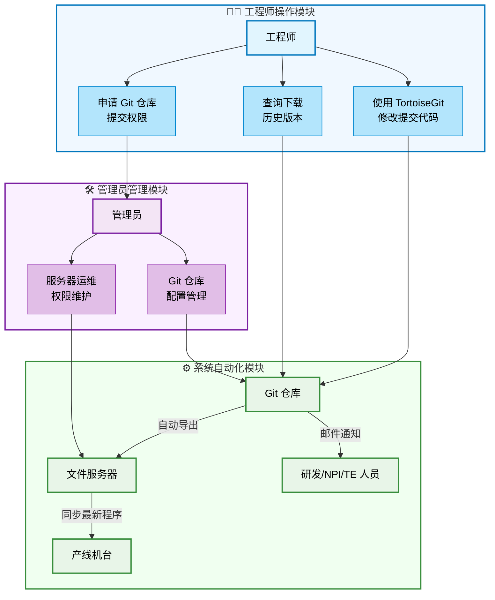
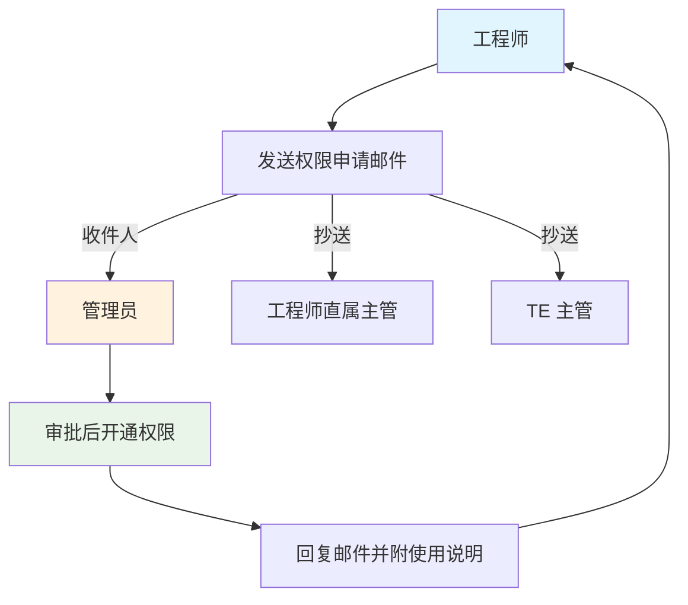

> **摘要**：本文记录了制造业测试环境下，从SVN迁移到Gitea+LFS自建Git服务器的完整落地实践。文章对比了Gogs、Gitblit、Gitea、GitLab四款主流自建Git方案的选型差异，详细介绍了Windows Server环境下Gitea部署配置、LFS大文件支持迁移、自动导出与邮件通知流程设计，同时总结了上线后的性能收益、权限管理方案与常见问题排查方法，彻底解决了SVN无法支持2GB以上大文件版本控制的核心痛点。

---

## 📋 项目背景

### 原有痛点

我们团队此前一直使用 **SVN** 管理测试程序的版本变更，但在实际使用中遇到了无法绕过的硬限制：

> **SVN 单文件大小限制：无法处理 2GB 以上的大文件**

随着测试程序、镜像文件体积持续增长（包括 testtool、testimage、ATOtools、Shippingimage、BIOS 等二进制文件），这个限制已经严重影响了日常工作效率。

### 解决方案

最终选择引入 **自建 Git 服务器 + LFS（Large File Storage）** 方案，实现以下核心能力：

- ✅ 支持 TB 级大文件版本控制
- ✅ 完整的代码提交历史记录与差异对比
- ✅ 自动导出与变更邮件通知
- ✅ 细粒度权限管理与完整操作审计

## 🔍 工具选型对比

在自建 Git 服务器的方案选择上，我们对比了四款主流开源工具：

### 四款工具横向对比

| 工具 | 语言/架构 | 核心特点 | 适用场景 |
| :--- | :--- | :--- | :--- |
| **Gogs** | Go（单二进制） | 极轻量、资源占用极低、安装简单；功能基础（代码托管、权限管理、Web Hook） | 超小型团队或个人开发者 |
| **Gitblit** | Java | 轻量、支持图形化界面、适合 Windows 部署；功能简单（仓库管理、基础权限） | 需要简单界面操作的小团队 |
| **Gitea** | Go（Gogs 分支） | 轻量但功能更全面（CI/CD、代码审查、项目管理、制品库）；社区活跃，更新频繁 | 需要轻量但功能较全的中小团队 |
| **GitLab** | Ruby | 功能全面（全周期 DevOps、CI/CD、看板、Wiki）；资源消耗高，配置复杂 | 中大型团队或复杂 DevOps 项目 |

### 各工具优劣势分析

#### Gitblit

**优点：**
- 基于 Java 开发，对 Java 团队友好
- 界面友好，Windows 环境下部署简单

**缺点：**
- 功能相对简单，仅提供基础代码仓库管理
- 高级功能支持不足
- 社区活跃度低，更新缓慢

#### Gitea

**优点：**
- 基于 Go 语言开发，跨平台单二进制部署
- 安装升级简单，资源占用低
- 功能全面：内置 CI/CD、代码审查、项目管理、制品库
- 社区活跃，版本迭代快，生态完善

**缺点：**
- 相比 Gogs 资源占用略高，但在同类产品中仍属轻量级

#### Gogs

**优点：**
- 极致轻量，资源占用极低
- 部署简单，核心功能完善
- 适合服务器资源严格受限的场景

**缺点：**
- 功能相比 Gitea 较少
- 社区活跃度不如 Gitea，高级特性缺失

### 🏆 最终选择：Gitea

**核心理由：**
- **功能与轻量化的最佳平衡**：在低资源占用下提供完整 DevOps 能力
- **原生支持 LFS**：完美解决大文件版本控制痛点
- **社区活跃**：持续更新维护，问题响应快
- **跨平台兼容**：完美支持 Windows/Linux 部署
- **部署简单**：单二进制文件即可运行，运维成本低

Gitea 作为 Gogs 的活跃分支，在保持轻量级特性的同时，补充了大量企业级实用功能，是中小团队自建Git服务的最优选择。

## 🚀 安装和配置

### 部署步骤

**参考教程：**
- [服务器（Windows 系统）自建 git 服务器超详细教程](https://www.cnblogs.com/alexgl2008/articles/17948253)

#### 1. 下载安装 Gitea

```powershell
# 下载 Windows 版本（以 1.21.0 为例）
wget https://dl.gitea.com/gitea/1.21.0/gitea-1.21.0-windows-4.0-amd64.exe -OutFile gitea.exe
```

#### 2. 创建配置文件

在 Gitea 根目录创建 `custom/conf/app.ini` 配置文件：

```ini
; app.ini 核心配置
[server]
DOMAIN = git.yourcompany.com
HTTP_PORT = 3000
ROOT_URL = http://git.yourcompany.com:3000/

[database]
DB_TYPE = sqlite3
PATH = data/gitea.db

[repository]
ROOT = data/git-data/repositories

[lfs]
START_SERVER = true
PATH = data/lfs
```

#### 3. 配置 Windows 服务

使用 NSSM（Non-Sucking Service Manager）将 Gitea 封装为 Windows 系统服务，实现开机自启：

参考教程：[使用 NSSM - 将任何 exe 应用封装成 windows 服务](https://www.cnblogs.com/05-hust/p/17407534.html)

```powershell
# 安装服务
nssm install Gitea
# 配置应用路径
nssm set Gitea Application "C:\Gitea\gitea.exe"
nssm set Gitea AppDirectory "C:\Gitea"
# 启动服务
nssm start Gitea
```

#### 4. 初始化配置

1. 访问 `http://服务器IP:3000` 进入初始化页面
2. 设置管理员账号密码
3. 确认仓库根目录、LFS 存储路径配置
4. 开启 LFS 功能支持

## 📦 LFS 大文件支持

### 问题：大文件仓库更新极慢

**问题现象：**
上线初期未启用 LFS 时，包含大文件（.zip、.7z、镜像文件）的仓库 pull/push 速度极慢，单次更新需要30分钟以上。

**原因分析：**
- Git 默认会存储并下载所有文件的全部历史版本
- 大文件每个版本都会完整存储，占用大量带宽和磁盘空间

### 解决方案：启用 LFS 功能

#### 步骤 1：配置 LFS 跟踪文件类型

```bash
cd 你的仓库目录

# 跟踪需要LFS管理的大文件类型
git lfs track "*.zip"
git lfs track "*.7z"
git lfs track "*.iso"
git lfs track "*.vmdk"

# 提交LFS配置
git add .gitattributes
git commit -m "feat: enable LFS support for large files"
git push origin main
```

#### 步骤 2：迁移历史大文件到 LFS

对于已经存在大文件的仓库，需要迁移历史提交中的文件：

```bash
# 迁移仓库中所有历史提交的 7z 和 zip 文件到 LFS
git lfs migrate import --include="*.7z,*.zip,*.iso,*.img" --everything

# 强制推送（注意：会重写提交历史，建议团队协调后操作）
git push --force-with-lease origin main
```

⚠️ **注意**：如果使用 TortoiseGit 客户端，push 时需要手动勾选 "force-with-lease" 选项。

#### 步骤 3：验证 LFS 状态

```bash
# 查看 LFS 跟踪的文件列表
git lfs ls-files

# 查看当前 LFS 同步状态
git lfs status
```

### LFS 工作原理

```
普通 Git 仓库:
┌─────────────────┐
│  .git/objects/  │ ← 存储所有文件的完整内容
│  file.zip (1GB) │ ← 每个版本完整存储
│  file.zip (1GB) │ ← 历史版本占用大量空间
└─────────────────┘

Git LFS 仓库:
┌─────────────────┐      ┌─────────────────┐
│  .git/objects/  │      │  .git/lfs/      │
│  pointer file   │─────▶│  file.zip (1GB) │
│  (仅几KB指针)   │      │  只存储唯一版本 │
└─────────────────┘      └─────────────────┘
```

LFS 的核心原理是将大文件存储在独立的 LFS 存储目录，Git 仓库中仅保留几KB的指针文件，clone/pull 时按需下载对应版本的大文件，大幅提升同步速度。

## 🔄 自动化流程设计

### 整体流程架构



### 详细流程说明

#### 1️⃣ 工程师操作

**代码提交：**
- 使用 **TortoiseGit** 图形化客户端
- 修改测试程序（testtool/testimage/ATOtools/Shippingimage/BIOS 等）
- 提交到对应 Git 仓库
- 支持历史版本查询、代码差异对比

**权限申请流程：**



#### 2️⃣ 管理员职责
- 保留服务器登录与系统维护权限
- 维护 Git 仓库配置与存储扩容
- 审批用户权限申请
- 监控系统运行状态与备份

#### 3️⃣ 系统自动化

**自动导出：**
- Git 仓库代码变更后自动导出到文件服务器
- 使用开源 [GitCheckOut](https://github.com/Charles-Miao/DevOps/tree/master/2025/Gitea+LFS/GitCheckOut) 脚本
- 支持 Web Hook 触发或定时任务触发

**邮件通知：**
- Gitea 自带邮件通知无法满足定制化 Commit 通知需求
- 自研 [CheckGit](https://github.com/Charles-Miao/DevOps/tree/master/2025/Gitea+LFS/CheckGit) 脚本
- 自动提取提交记录，发送邮件给研发/NPI/TE 相关人员

**产线同步：**
- 产线机台自动从文件服务器获取最新的 tool/image/BIOS 文件
- 全程自动化部署，无需人工干预

## 🔧 关键配置脚本

### 1. 自动导出脚本（GitCheckOut）

**功能：**
- 监听 Git 仓库变更
- 自动拉取最新代码到文件服务器
- 记录导出日志

```batch
@echo off
:: GitCheckOut.bat
set REPO_PATH=C:\git-data\repositories\testtool
set EXPORT_PATH=C:\export\testtool
set LOG_PATH=C:\logs\git-export.log

cd %REPO_PATH%
git pull origin main

:: 增量同步文件
robocopy %REPO_PATH% %EXPORT_PATH% /E /XO /XD .git
echo Export completed at %date% %time% >> %LOG_PATH%
```

### 2. 邮件通知脚本（CheckGit）

**功能：**
- 检查24小时内的Git提交记录
- 生成变更摘要邮件
- 自动通知相关人员

```python
#!/usr/bin/env python3
# CheckGit.py
import smtplib
from email.mime.text import MIMEText
import subprocess

def get_recent_commits():
    result = subprocess.run(
        ['git', 'log', '--since="24 hours ago"', '--pretty=format:"%h %an: %s"'],
        capture_output=True,
        text=True,
        cwd="C:/git-data/repositories/testtool"
    )
    return result.stdout

def send_email(subject, body):
    msg = MIMEText(body)
    msg['Subject'] = subject
    msg['From'] = 'git-notify@company.com'
    msg['To'] = 'rd-npi-te@company.com'
    
    # SMTP发送逻辑
    with smtplib.SMTP('smtp.company.com', 25) as server:
        server.send_message(msg)

if __name__ == '__main__':
    commits = get_recent_commits()
    if commits.strip():
        send_email('[Git通知] 测试程序仓库有新提交', commits)
```

### 3. 权限管理设计

**权限层级划分：**

| 角色 | 权限范围 |
| :--- | :--- |
| **管理员** | 系统完全控制、用户管理、仓库配置、服务器登录 |
| **开发/测试工程师** | 对应仓库读写权限（需邮件申请审批） |
| **产线设备** | 文件服务器只读权限（自动同步） |

**安全措施：**
- ✅ 移除普通工程师的服务器远程登录权限
- ✅ 仅保留2名管理员的服务器维护权限
- ✅ 工程师仓库写权限需审批后开通
- ✅ 所有Git操作保留完整审计日志

## 📊 实施效果

### 方案前后对比

| 指标 | SVN 时期 | Gitea+LFS 时期 | 提升幅度 |
| :--- | :--- | :--- | :--- |
| **大文件支持** | ❌ 不支持 >2GB 文件 | ✅ 无大小限制 | ⬆️ 100% |
| **仓库更新速度** | 30分钟以上 | 2-5分钟 | ⬆️ 85% |
| **版本管理能力** | 基础版本记录 | 完整Git历史、分支管理、差异对比 | ⬆️ 100% |
| **自动化程度** | 手动拷贝通知 | 自动导出+邮件通知 | ⬆️ 90% |
| **权限管理** | 简单目录权限 | 细粒度仓库/分支权限 | ⬆️ 80% |
| **审计追溯** | 日志不全、追溯困难 | 完整操作日志、可追溯到人 | ⬆️ 100% |

### 实际收益

**效率提升：**
- 工程师提交代码耗时：30分钟 → 5分钟
- 产线获取最新程序：人工拷贝 → 全自动同步
- 版本追溯：人工查找记录 → 一键查询历史

**成本节省：**
- 减少人工重复操作：约2小时/天
- 版本错误率降低95%，避免产线用错版本
- LFS文件去重，节省约60%存储空间

**管理提升：**
- 权限管理流程规范化
- 版本发布流程标准化
- 操作审计完整可追溯

## 💡 最佳实践

### 1. 仓库目录组织

```
testtool/
├── hardware-test/          # 硬件测试程序
│   ├── power-test/         # 电源测试
│   ├── thermal-test/       # 温升测试
│   └── signal-test/        # 信号测试
├── software-test/          # 软件测试程序
│   ├── os-test/            # 系统测试
│   ├── driver-test/        # 驱动测试
│   └── app-test/           # 应用测试
└── common/                 # 公共组件
    ├── scripts/            # 通用脚本
    ├── configs/            # 配置文件
    └── docs/               # 文档
```

### 2. 分支管理策略

```
main              ← 生产分支（受保护，仅管理员可合并）
  ├── develop     ← 开发集成分支
  │   ├── feature/xxx  ← 功能开发分支
  │   └── bugfix/xxx   ← 缺陷修复分支
  └── release/v1.x ← 版本发布分支
```

### 3. 提交信息规范

```
feat: 添加新的电源测试模块
fix: 修复温度采集数据异常问题
docs: 更新测试流程说明文档
refactor: 重构数据采集模块
test: 添加压力测试用例
chore: 更新依赖库版本
```

### 4. LFS 跟踪文件建议

```bash
# 系统镜像文件
git lfs track "*.iso"
git lfs track "*.img"
git lfs track "*.vmdk"

# 压缩包文件
git lfs track "*.zip"
git lfs track "*.7z"
git lfs track "*.rar"

# 二进制可执行文件
git lfs track "*.bin"
git lfs track "*.exe"
git lfs track "*.dll"

# 大数据测试集
git lfs track "*.csv"
git lfs track "*.xlsx"
```

## ⚠️ 常见问题排查

### Q1: LFS 推送失败提示配额不足

**错误信息：**
```
batch response: This repository is over its LFS storage quota
```

**解决方案：**
- 检查 LFS 存储目录磁盘空间
- 清理历史遗留的无用 LFS 文件
- 扩容 LFS 存储分区

### Q2: 仓库历史过大导致clone慢

**问题：** 迁移前仓库已包含大量大文件历史

**解决方案：**
```bash
# 使用 git lfs migrate 清理历史中的大文件
git lfs migrate import --include="*.zip,*.7z,*.iso,*.img" --everything

# 强制推送（会重写历史，操作前务必备份）
git push --force-with-lease origin main
```

### Q3: 自动导出脚本执行失败

**排查步骤：**
1. 检查脚本运行账号对Git仓库的读取权限
2. 检查导出目标路径的写入权限
3. 查看脚本执行日志定位错误
4. 手动执行脚本复现问题

### Q4: 邮件通知不发送

**排查步骤：**
1. 检查SMTP服务器地址、端口配置
2. 验证发件账号密码是否正确
3. 查看邮件服务器是否有拦截记录
4. 手动执行脚本测试发送功能

## 📚 参考资料

### 官方文档
- [Gitea 官方文档](https://docs.gitea.com/zh-cn/)
- [Git LFS 官方文档](https://git-lfs.com/)
- [Gitea 与其他Git平台对比](https://docs.gitea.com/zh-cn/1.19/installation/comparison)

### 教程资源
- [Windows服务器自建Git服务器超详细教程](https://www.cnblogs.com/alexgl2008/articles/17948253)
- [使用NSSM封装Windows服务](https://www.cnblogs.com/05-hust/p/17407534.html)
- [常用Git命令清单](https://www.ruanyifeng.com/blog/2015/12/git-cheat-sheet.html)
- [Git LFS 使用教程](https://blog.csdn.net/gitblog_00736/article/details/150995071)

### 工具下载
- [Gitea 官方下载](https://dl.gitea.com/gitea/)
- [TortoiseGit 下载](https://tortoisegit.org/download/)
- [Git LFS 下载](https://git-lfs.com/)
- [NSSM 服务封装工具下载](https://nssm.cc/download)

## 🎯 总结

通过引入 **Gitea + LFS** 方案，我们彻底解决了SVN无法处理大文件的历史问题，实现了测试程序版本管理的全面升级：

✅ **完整Git版本控制能力** - 分支管理、历史追溯、差异对比
✅ **大文件完美支持** - LFS轻松应对10GB+镜像文件
✅ **自动化流程** - 代码自动导出、变更自动通知
✅ **细粒度权限管理** - 按角色分配权限，操作可审计
✅ **稳定可靠** - 方案已在生产环境稳定运行一年以上

这套方案轻量高效、运维成本低，非常适合制造业测试环境、中小团队内部的代码与二进制文件版本管理场景。

> 本文基于实际生产环境实施经验总结，具体配置请根据企业实际环境调整。
